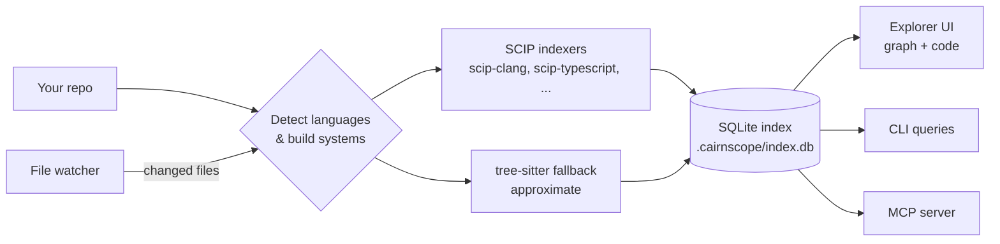

<div align="center">


# Cairnscope

**See how your code fits together.**
An interactive source explorer: a live symbol graph and the real source, side by side, moving together as you click.

[](https://github.com/virajshoor/cairnscope/actions/workflows/ci.yml)
[](LICENSE)


[Why](#why-cairnscope) · [Install](#install) · [Quick start](#quick-start) · [Languages](#languages) · [For AI agents](#for-ai-agents-mcp) · [How it works](#how-it-works) · [Limitations](#honest-limitations) · [Roadmap](docs/ROADMAP.md)

</div>

---

> [!WARNING]
> Cairnscope is in **early development**. The core index and store work; the explorer UI, packaging and most language integrations are being built now. See [docs/STATUS.md](docs/STATUS.md) for what works today.

## Why Cairnscope

Reading unfamiliar code is mostly answering three questions: *who calls this, what does it call, and where does it live?* An IDE answers them one search at a time. Cairnscope draws all three at once as a small, readable graph next to the source, and keeps the two in sync as you move.

| | |
|---|---|
| 🧭 **Two panes, one focus** | Click a symbol in the graph or the code. You see its definition, callers, callees, members and inheritance. |
| 🪨 **Trails** | Every hop is recorded as a *trail*: a path through the code you can name, bookmark, and export as Markdown for a PR, an onboarding doc or a bug report. |
| ⚡ **Zero config** | `cairnscope open .` detects your languages and build system, runs the right indexer and opens the explorer. If something is missing, it tells you exactly how to fix it. |
| 🌍 **Many languages, no per-language indexers** | Built on [SCIP](https://github.com/scip-code/scip), so it reuses the compiler-grade indexers maintained by the community. |
| 🔒 **Local-first** | No accounts, no telemetry, no network calls with your code. The index is a single SQLite file in `.cairnscope/`. |
| 🤖 **Agent-ready** | The same index answers queries from the CLI and from a built-in [MCP](https://modelcontextprotocol.io) server. |
| ⌨️ **Keyboard-first** | Every action has a shortcut. The graph is navigable with arrow keys and screen-reader labelled. |

## Install

> Release binaries and package-manager installs land with the first tagged release.

**From source** (Rust 1.85+ and Node 20+):

```sh
git clone https://github.com/virajshoor/cairnscope
cd cairnscope
cargo install --path .
```

## Quick start

```sh
cd path/to/your/project
cairnscope index        # detect languages, run indexers, build .cairnscope/index.db
cairnscope open         # open the explorer in your browser (served on 127.0.0.1 only)
```

Query from the terminal:

```sh
cairnscope search Handler         # find symbols
cairnscope callers parseRequest   # who calls it
cairnscope callees parseRequest   # what it calls
cairnscope refs parseRequest      # every reference, with file:line
```

## Languages

Cairnscope runs the standard SCIP indexer for each language and caches it. When no indexer is available or it fails, Cairnscope falls back to [tree-sitter](https://tree-sitter.github.io) and labels those results **approximate**.

| Language | Indexer | You need |
|---|---|---|
| TypeScript / JavaScript | [scip-typescript](https://github.com/sourcegraph/scip-typescript) | Node.js |
| Python | [scip-python](https://github.com/sourcegraph/scip-python) | Node.js |
| Go | [scip-go](https://github.com/scip-code/scip-go) | Go toolchain |
| Rust | rust-analyzer (`scip` subcommand) | `rustup component add rust-analyzer` |
| C / C++ | [scip-clang](https://github.com/sourcegraph/scip-clang) | `compile_commands.json` |
| Java / Kotlin / Scala | [scip-java](https://github.com/sourcegraph/scip-java) | JDK + build tool |
| Anything else | tree-sitter fallback | nothing (approximate) |

## For AI agents (MCP)

Agents can query the same index you browse:

```sh
cairnscope mcp     # stdio MCP server: definition, references, callers, callees, neighborhood
```

Example Claude Code / MCP client config:

```json
{ "mcpServers": { "cairnscope": { "command": "cairnscope", "args": ["mcp"] } } }
```

## How it works



Cairnscope does **not** write its own language indexers, because keeping per-language indexers alive is the work that wore down earlier tools. It consumes [SCIP](https://github.com/scip-code/scip), the open code intelligence format, and derives a call graph from where each reference sits. Design details are in [docs/DESIGN.md](docs/DESIGN.md).

## Honest limitations

- **Pre-alpha.** APIs, CLI flags and the index format will change.
- **C/C++ needs a compilation database.** Run `cmake -DCMAKE_EXPORT_COMPILE_COMMANDS=ON` or `bear -- make`. Without one you get approximate results.
- **scip-clang has no Windows build.** C/C++ on Windows is tree-sitter-only for now.
- **"Calls" are derived.** SCIP records references, not calls. A reference to a function inside another function's body counts as a call, which is right almost always but not for function pointers passed as values.
- **Incremental indexing reruns the project indexer.** Only changed files are re-ingested, but the SCIP indexer itself still runs project-wide.

## Contributing

Contributions are welcome. See [CONTRIBUTING.md](CONTRIBUTING.md). Everything is plain Rust + TypeScript: no Qt, no LLVM build.

## License

[Apache-2.0](LICENSE). Third-party components are listed in [THIRD_PARTY_NOTICES.md](THIRD_PARTY_NOTICES.md).

Cairnscope is an independent project inspired by the ideas of the archived Sourcetrail explorer. It contains no Sourcetrail code and is not affiliated with Coati Software.
